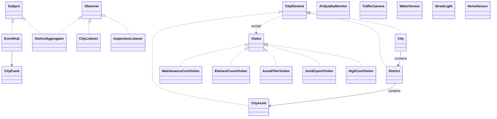

# Smart City Monitoring

This Java 17 project uses Observer for city sensor events and Visitor for reports about a city tree. It uses only the JDK and JUnit 5.

## Run

Open `Main.java` in IntelliJ and run it. The default uses three producer threads. Pass a number such as `4` to use four.

Run tests with `mvn test`.

## UML class diagram

## Observer design

`AirQualitySource` and `TrafficSource` publish immutable `CityEvent` objects. The generic `Subject<E>` and `Observer<E>` interfaces allow different event subjects and listeners. Five named listener types handle alerts, traffic, statistics, dashboard summaries, and reports. `DistrictAggregator` is both an observer and a subject. It counts received updates and republishes a city summary. A listener can subscribe or unsubscribe during its own update. `EventHub` uses concurrent collections so publishing does not lock the whole subject.

Events use push: each immutable event carries its type, district, and message to matching observers. This keeps listeners from needing to query the sources.

## Visitor design

The Composite tree has `City`, `District`, and five asset types. Visitors perform the tree traversal, so element classes stay focused on their data and every operation controls its own walk. The operations calculate maintenance cost, count elements, filter expensive assets, count high-cost assets, and export nested JSON. Element objects only store names, IDs, costs, and child lists.

Observer and Visitor are connected by `InspectionListener`. An air alert for its district runs the cost visitor on that district only. It publishes the result as a new inspection report event.

## Concurrency and tests

Main is the single composition root and supplies dependencies through constructors. The demo runs at least three producer tasks in an `ExecutorService` and waits for graceful completion. The stress test publishes 1,000 events from each of four threads and checks an exact total of 4,000. Tests also cover event routing, subscriptions, Visitor results, JSON nesting, and the Observer-Visitor integration.

## Trade-off commits

### Add a visitor without changing elements

Commit `f7426bf` (`Add visitor without changing city elements`) adds `HighCostVisitor` and its test. Changed files:

- `src/main/java/kz/edu/smartcity/CityVisitors.java`
- `src/test/java/kz/edu/smartcity/CityPulseTest.java`

This shows the benefit of Visitor: a new operation can be added without changing the element classes.

### Add a new element

Commit `f98cd50` (`Add noise sensor and update visitors`) adds `NoiseSensor`. Changed files:

- `src/main/java/kz/edu/smartcity/CityElements.java`
- `src/main/java/kz/edu/smartcity/CityVisitors.java`
- `src/main/java/kz/edu/smartcity/Main.java`
- `src/test/java/kz/edu/smartcity/CityPulseTest.java`

This shows the cost of Visitor: each visitor must learn how to handle a new element type.

The project has local commits for the required changes. The commits were created during this implementation session; add later progress commits over the required two-week period before submission if your instructor checks their dates.

